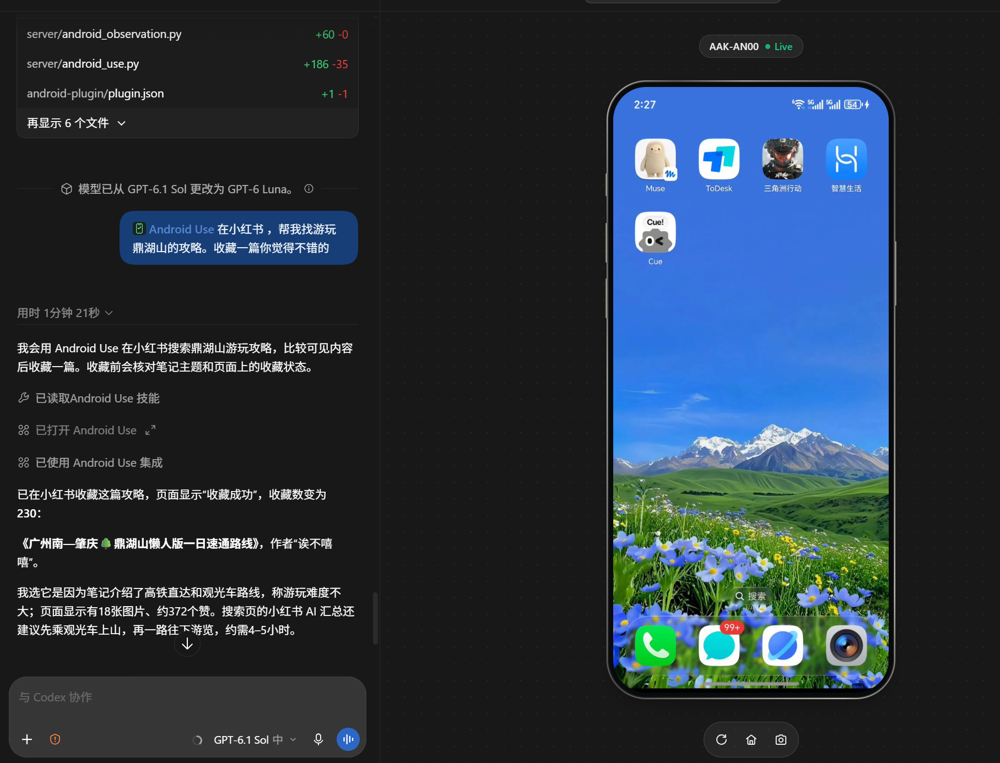

# Android Use

A Codex plugin for Windows and USB-connected Android phones, maintained by [NaNQiQ](https://github.com/NaNQiQ).

Let Codex open apps, inspect pages, tap, swipe, enter Unicode text and verify action results. The native MCP Apps sidebar displays the phone screen in the current chat. Control uses ADB and UIAutomator2; preview uses scrcpy with screenshot fallback. No Mac or Xcode is required.

[中文](README.md) · **English**



*Actual usage screenshot provided by the project maintainer.*

**Before use, connect your own Android phone with a USB data cable, enable USB debugging and authorize this computer on the phone.** UIAutomator2 may deploy its automation service on first connection. Installing the computer plugin alone does not prove the phone is ready.

## Ask your AI to install it

Copy this prompt into a local Codex chat that can execute Windows PowerShell commands:

```text
Help me install and configure Android Use on this Windows computer:
https://github.com/NaNQiQ/Android-Use

Read the repository README, scripts/install-android.ps1 and
skills/android-use-setup/SKILL.md first. Check native Windows PowerShell,
Codex CLI, Python, ADB, scrcpy and my USB-connected Android phone.
Verify support for codex plugin marketplace, plugin add and mcp add.
Reuse installed dependencies and existing Android Use configuration.
Do not copy the author's local paths, serial number or plugin cache,
and do not delete my runtime data to reinstall.

Clone the repository to a suitable local directory and run from its root:
powershell -ExecutionPolicy Bypass -File scripts/install-android.ps1
Use -Python / -Serial when needed. Explain missing dependencies and help
install them from official sources. Match scrcpy and scrcpy-server versions.
The installer stages the plugin, registers its marketplace, installs its
skills and configures android_use MCP; do not register duplicate tools.

If the current chat has not loaded the tools, tell me to reconnect,
restart or open a new chat, then continue using android-use-setup.
Only declare readiness when android_ready returns ready=true.
Open android_screen and obtain a valid frame before confirming the sidebar.
Report whether it uses scrcpy video or screenshot fallback.

Give me clear steps and wait when USB authorization, unlocking, drivers
or account login require my action. Do not bypass the lock screen or
switch to wireless ADB. Verify connection and preview without sending
messages, buying anything or changing my system settings.
```

Other AI clients with local command access can help install it. The plugin picker and native phone sidebar described here target Codex; an ordinary browser chat cannot access your USB phone directly.

## Environment and dependencies

| Requirement | Purpose |
| --- | --- |
| Native Windows + PowerShell | Current installation target; run on Windows rather than substituting WSL paths or Linux commands |
| Codex desktop client + CLI | The desktop client renders the MCP Apps sidebar; the CLI registers plugins/MCP. It must support `codex plugin`, `plugin marketplace` and `mcp add`; CLI 0.149.1 was validated |
| Python 3.12+ | Android MCP and installer; current checks use Python 3.13. Use `-Python` if `python` is not your intended interpreter |
| ADB / Android SDK Platform-Tools on PATH | USB discovery and control; full Android Studio is unnecessary |
| Android phone + USB data cable | USB debugging enabled, computer authorized, phone unlocked; vendor drivers or input-debugging permission may be needed |
| scrcpy, recommended | Video preview; scrcpy 4.0 was validated. The client and `scrcpy-server` must match; other versions need verification. Missing scrcpy uses screenshot fallback |
| Git | Clone/update; a downloaded source ZIP also works |
| Node.js / npm, for development | Rebuild/test the sidebar; CI uses Node.js 24. Installing the checked-in HTML does not require rebuilding UI |

Pinned Python dependencies are installed into a separate environment from [requirements-android.txt](requirements-android.txt). No root, Mac, Xcode or standalone Appium Server is required.

Official resources: [Codex plugins](https://developers.openai.com/plugins/build/plugins), [Python for Windows](https://www.python.org/downloads/windows/), [Android Platform-Tools](https://developer.android.com/tools/releases/platform-tools), [scrcpy for Windows](https://github.com/Genymobile/scrcpy/blob/master/doc/windows.md), and [Codex CLI installation](https://developers.openai.com/cookbook/examples/codex/using_goals_in_codex#quickstart-using-goals). Installing the CLI through npm requires Node.js/npm.

## Prepare your phone and install

1. Connect a USB data cable, enable developer options and USB debugging, and unlock the phone.
2. Accept the debugging authorization prompt; install the vendor's official Windows USB driver if required.
3. Run `adb devices -l`. Your target should report `device`; `unauthorized` needs phone authorization, and `offline` needs connection recovery.
4. For multiple devices, use your own serial with `-Serial`.

```powershell
git clone https://github.com/NaNQiQ/Android-Use.git
cd Android-Use
powershell -ExecutionPolicy Bypass -File scripts/install-android.ps1
```

The installer creates a separate Python environment, stages the plugin, registers a local marketplace and configures the `android_use` MCP launcher. Personal paths and device selection are stored outside the repository in `%LOCALAPPDATA%/AndroidUse/config.json`. Use `-Serial YOUR_DEVICE_SERIAL` for multiple devices.

To select a Python interpreter and device, replace these placeholders with your own values:

```powershell
powershell -ExecutionPolicy Bypass -File scripts/install-android.ps1 -Python 'C:\Path\To\Python\python.exe' -Serial YOUR_DEVICE_SERIAL
```

The installer downloads Python dependencies. Source ZIP users run the same script from the extracted project root. Normal installation uses the existing sidebar HTML and does not require an npm build.

Reconnect Codex or restart it after installation. Select **Android Use** from the plugin picker and ask it to check the connected phone and open its screen.

Readiness requires `android_ready.ready=true`; sidebar acceptance requires a valid phone frame. An installer exit code alone does not prove the current chat has loaded the tools. Healthy connections are reused across tasks.

## Updates and troubleshooting

```powershell
git pull --ff-only
powershell -ExecutionPolicy Bypass -File scripts/install-android.ps1
```

Reconnect/restart Codex after updating. The installer reuses the Python environment and device selection; do not delete personal runtime data for a routine upgrade.

| Symptom | Check |
| --- | --- |
| CLI missing or no plugin commands | Check installation, PATH and `codex plugin --help` |
| No USB device | Check data cable, debugging authorization and vendor driver |
| Installed but no tools in chat | Reconnect, restart or open a new chat and enable Android Use |
| Slow screenshot-only preview | Inspect source/faults in `android_doctor` / `android_screen`; verify scrcpy, matching server and PyAV |
| Wrong device | Use your own `-Serial` or follow the setup skill to select the target |

## Development

```powershell
& "$env:LOCALAPPDATA/AndroidUse/venv/Scripts/python.exe" tests/test_android.py
npm ci --prefix ui
npm run build --prefix ui
npm test --prefix ui
python scripts/package_android.py
```

The root contains the Android plugin manifests, `skills/`, `server/`, editable sidebar source in `ui/`, and automated checks in `tests/`. The distribution is generated under `dist/`.

## Limitations

Accessibility coverage is heuristic; screenshots and trees are sampled sequentially. Dispatch is reported separately from verified postconditions. Custom transient banners may be missed. Preview delivers the latest decoded video frame through MCP polling; 60 fps is a capture ceiling, not a guaranteed sidebar rate or zero-latency claim. Device vendors, protected screens and rotation need broader testing. See [validation notes](VALIDATION.android.md).

## License and attribution

MIT. Portions of the sidebar and interaction design derive from iPhone Use. Original copyright and third-party notices are retained in [LICENSE](LICENSE), [NOTICE.android.md](NOTICE.android.md) and [THIRD_PARTY_NOTICES.md](THIRD_PARTY_NOTICES.md).
